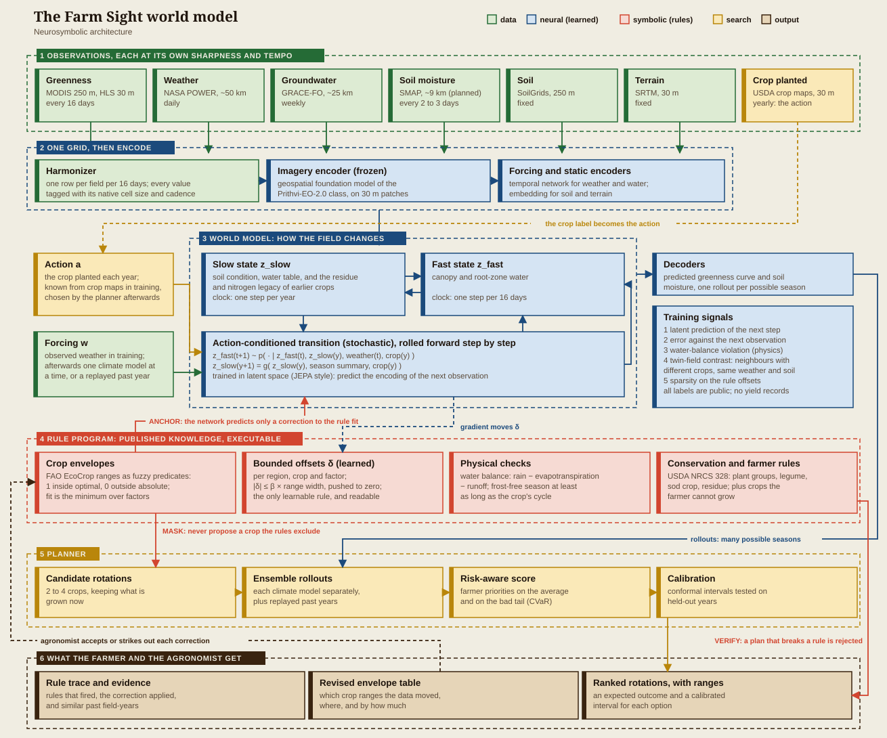

# Farm Sight

**NASA Space Apps Challenge 2026 — [Field Shift: Adapting Farms with NASA Data](https://www.spaceappschallenge.org/2026/challenges/field-shift-adapting-farms-with-nasa-data/)**

> Enter your farm's location. We fill in ~20 criteria from NASA data and
> recommend crop rotations, showing the reasons behind each one.

**Live app: https://sharvin-coder-nasa-space-apps-field-shift-app-265jl1.streamlit.app/**

## How it works

1. **Location in.** The farmer enters a location (or drops a pin).
2. **Auto-fill.** We pull ~20 criteria on climate, water, soil and field
   history from NASA and open soil data. The farmer types none of it.
3. **Priorities.** The farmer sets what matters most: profit, soil health,
   water saving. Any auto-filled value can be overridden.
4. **Recommendation.** We rank rotations and list the top criteria behind
   each one, so the farmer can see why.

## Ground rules

- **Real data only.** No invented yields, prices or scores. If a value can't
  be fetched, show it as missing.
- **No invented weights.** Crop suitability comes from published crop
  requirement ranges and USDA guidance, with the source cited. Where we had
  to make a choice, it is listed under known limits.
- **Explain every recommendation.** Each one lists the criteria that drove it.
- **Say what it can't do.** It is decision support, not a yield forecast.

## The criteria

| # | Criterion | Source | Status |
|---|---|---|---|
| 1 | Growing-season rainfall | NASA POWER | done |
| 2 | Growing degree days | NASA POWER | done |
| 3 | Heat days (max > 32 °C) | NASA POWER | done |
| 4 | Frost-free days | NASA POWER | done |
| 5 | Solar radiation | NASA POWER | done |
| 6 | Aridity index (annual rain ÷ reference evapotranspiration, Hargreaves FAO-56) | NASA POWER | done |
| 7 | Year-to-year rainfall variability | NASA POWER | done |
| 8 | Root-zone soil wetness | NASA POWER (MERRA-2); upgrade to SMAP | done (interim source) |
| 9 | Dry years in the last 10 | NASA POWER | done |
| 10 | Groundwater wetness percentile, latest week and 10-year average | NASA GRACE / GRACE-FO drought indicator ([NDMC](https://nasagrace.unl.edu/)) | done |
| 11 | Slope | NASA SRTM 30 m via [OpenTopoData](https://www.opentopodata.org/) | done |
| 12 | Peak greenness (NDVI): 10-year average and trend | NASA MODIS MOD13Q1, 250 m | done |
| 13 | Greenness in dry seasons against other years | NASA MODIS and NASA POWER | done |
| 14 | Projected 2040 temperature change | NASA NEX-GDDP-CMIP6 (POWER projection API) | done (US sites) |
| 15 | Projected 2040 rainfall change | NASA NEX-GDDP-CMIP6 (POWER projection API) | done (US sites) |
| 16 | Soil texture (clay, sand) | ISRIC SoilGrids | done |
| 17 | Soil organic carbon | ISRIC SoilGrids | done |
| 18 | Soil pH | ISRIC SoilGrids | done |
| 19 | Crops grown at this spot, last 5 years | USDA Cropland Data Layer (contiguous US only) | done |
| 20 | Farmer priorities (climate fit / soil / water) | Farmer input | done (no profit score) |

## Run it

```bash
uv venv --python 3.11
uv pip install --link-mode=copy -r requirements.txt
.venv/Scripts/streamlit run app.py
```

(On macOS/Linux use `.venv/bin/streamlit`.) The app opens in your browser:
click the map to place your field, check the crops pre-filled from USDA
satellite maps, set your
priorities, and correct auto-filled values if you know better (irrigation,
soil pH). The first load for a location takes about 5–10 seconds while it
calls six data services.

The page is laid out as a cross-section of the field, printed like a
soil-conservation poster. The satellite map and the top shift come first, then
the criteria in the order they sit in the field (the air, the surface, the
soil, the water below), and the fine print last. Each control sits beside what
it changes, and each rotation is drawn as a row of year strips coloured by
functional group. Map tiles are Sentinel-2 cloudless (EOX) with Esri reference
labels; every value on the page still comes from the live NASA and soil feeds.

The page has five tabs, so nothing is more than a short scroll away: **Your
field** (map, current rotation, top shift, report), **Rotations** (priorities,
constraints, climate time machine, ranking, ten-year replay), **Measurements**
(air, surface, soil, water, glossary), **The model** and **Fine print**.

### The Farm Sight world model (proposed)

"The model" tab and [MODEL.md](MODEL.md) set out the learning model we designed
to build on the rule engine: an action-conditioned world model of a single
field, tied to the agronomic rules as its anchor, mask and verifier.



Its distinguishing parts are a crop-as-action transition, a two-clock state
that carries one crop's legacy into the next season, rule ranges the data may
shift only within hard bounds (so what it learns is a readable table), a
twin-field causal training signal, and a verifier-guarded planner scored
across separate climate models. MODEL.md compares it with seven published
systems. **It is a design: not trained, and no result is claimed for it.**

### Explore, not just rank

- **Climate time machine.** A year slider blends today's climate (the
  2016–2025 average) toward the 2035–2044 projection, and two what-if sliders
  add your own shift (−2 to +4 °C, −30 to +30% rain). The ranking re-forms
  live and each option shows where it ranked with today's climate ("was #3
  today", "not offered today"). It is a straight-line what-if on crop fit,
  not a forecast.
- **Ten-year replay.** The current rotation and the top three options are
  re-scored with each of the last ten years' actual rain and temperature,
  with the three driest years lit, the worst year named, and the gap against
  the current rotation. Fit with that year's weather, not a harvest result.
- **Constraints.** Rule out crops you have no equipment, market or contract
  for; they are never added to an option.
- **One-page farm report.** A printable HTML download: what you entered, the
  key measurements with sources, current rotation against the top three
  (today, 2040 and worst-year fit, soil checks met and missed), questions for
  your agronomist generated from the results, and the limits.
- **Plain-language help.** A glossary worded to match the code, a short
  account of why each kind of crop helps the soil (from NRCS 328), and fine
  print on satellite versus ground measurements, how datasets of different
  resolution are combined, and where local judgment is needed.

### AI field analyst (optional)

With an Anthropic API key, the main panel gains an "AI reading of this field".
A language model (Claude) is given only the measurements and scores already on
the page and writes a short plain-language reading: what stands out, what the
top shift changes, and what to ask an agronomist. It never sets or changes a
score. Figures in its text are checked against the data and flagged if they
do not match. One reading is generated per field and settings, on request,
with a daily cap (`fieldshift/analyst.py`).

To switch it on, set `ANTHROPIC_API_KEY` as an environment variable locally,
or as a secret on Streamlit Community Cloud. Without a key the panel is
hidden and everything else works as before.

The same engine runs from the terminal:

```bash
.venv/Scripts/python -m fieldshift.recommend 42.03 -93.47 --current corn,soybean
```

- `--current corn,soybean` is what the farmer grows now. It is scored as the
  baseline, and offered rotations keep those crops and add to them.
- `--fit`, `--soil`, `--water` are the farmer's priority weights (default 1 each).
- `--json` prints everything, including all criteria and per-crop scores.
- `--year-fraction`, `--temp-delta`, `--rain-pct` run a what-if climate, and
  `--exclude alfalfa,canola` rules crops out.
- `python -m fieldshift.fingerprint <lat> <lon>` prints just the criteria.

Example (central Iowa, live data): corn → soybean scores 0.66; adding alfalfa
and a cool-season broadleaf raises it to 0.84 by meeting all four soil checks.

## How a recommendation is scored

Nothing here is a yield or profit forecast.

| Score | What it is | Source |
|---|---|---|
| Crop fit | 1 inside the crop's optimal range for temperature, annual rain and soil pH; 0 outside its absolute range; a straight line between. The lowest factor wins. Warm-season crops also need a long enough frost-free season; soil texture must be tolerated. | [FAO EcoCrop](https://github.com/OpenCLIM/ecocrop) ranges, unchanged, for 17 field crops (`fieldshift/crops.csv`) |
| Dry-year fit | Crop fit recomputed for the site's three driest of the last ten years | NASA POWER |
| Soil health | Share of four checks met: 3+ functional groups, a legume, a perennial sod crop, high-residue crops in at least half the sequence | USDA NRCS Conservation Practice Standard 328 (Conservation Crop Rotation) |
| Water saving | How low the rotation's average optimal-minimum rainfall is, scaled across the crop table | FAO EcoCrop |
| 2040 fit (shown, not scored) | Crop fit recomputed with today's temperature and rain shifted by the projected change to 2035–2044 | NASA NEX-GDDP-CMIP6 ensemble, SSP2-4.5 |

The final score is the weighted average of fit (crop fit and dry-year fit
averaged), soil health and water saving, using the farmer's weights.

**Known limits**
- **No profit score.** That needs real price and yield data. Markets,
  equipment and local practice are not considered, so some picks (canola in
  Iowa) are climatically fine but may not be practical.
- **EcoCrop is coarse.** In mild climates most crops score near 1, so soil
  and water scores decide the ranking.
- **EcoCrop quirk:** grain sorghum's absolute maximum rainfall is 700 mm, so
  it is ruled out as "too wet" in Iowa and eastern Nebraska. The output flags
  this.
- **Our own choices, for agronomist review:** each crop's functional group
  and residue class, the "3+ groups" threshold, the 0.2 minimum fit, and the
  soil texture cut-offs.
- **One growing window** (April–September, Northern Hemisphere) for all crops.
- **Climate resolution:** NASA POWER weather comes on a grid about 50 km
  wide, so neighbouring fields share climate values. Soil values are local.
- Soil values can be missing (for example in towns); those checks are skipped
  and the output says so.
- **Shown but not scored:** aridity, groundwater, slope and the 2040 fit are
  displayed for context. Turning them into score weights would mean inventing
  numbers.
- **2040 projection:** one emissions pathway (SSP2-4.5), ensemble mean only,
  mean temperature and total rain only (no extremes). The POWER projection
  service returned no data for test sites in India and Brazil, so outside the
  US these two criteria show as missing.
- **Groundwater** is a model-assimilated GRACE product on a 0.25° grid, and
  the 10-year average samples one week per year.
- **Slope** uses whole-metre SRTM elevations 90 m apart, so flat fields can
  read 1–3% from rounding alone. The free OpenTopoData service allows about
  1,000 lookups a day.
- **Crop history** is one pixel (10–30 m); a pin on a road or farmyard returns
  no crop. It comes from USDA NASS's image server, with the CropScape service
  as a fallback.
- **Soil** is read from the ISRIC map server, with the SoilGrids point API as
  a fallback (that API often times out). If a source fails, the app shows the
  value as missing and offers a retry.
- **Greenness (12–13)** is the yearly peak NDVI of one 250 m MODIS pixel,
  from good-quality 16-day composites between late April and mid September.
  A pin near a field edge mixes two fields, and the crop grown changes the
  peak, so the trend is not soil health on its own. It is read from the
  Planetary Computer copy of MOD13Q1 (seconds), with NASA's ORNL DAAC point
  service as a fallback (it can take a minute). Shown, not scored.

## Milestones

1. ~~Location → criteria → ranked rotations with reasons, in the terminal.~~ Done.
2. ~~Web app: map pin, criteria panel with overrides, priority sliders,
   recommendation cards.~~ Done (Streamlit, `app.py`).
3. ~~Remaining criteria and the 2040 view.~~ Done.
4. Pitch video and submission.

## Task split (three roles — claim one)

**Role A — Data**
- All 20 criteria are wired. Next: SMAP soil moisture in place of the MERRA-2 estimate.
- Make each criterion fail safely: missing stays missing.

**Role B — Recommendation engine**
- Crop table: each candidate crop's published tolerance ranges (temperature,
  rainfall, pH, soil texture, season length), with sources. FAO's EcoCrop
  database is the first place to check.
- Score each crop against the criteria; build rotations from rules that
  extension guidance supports (for example, a legume after a cereal).
- Weight by the farmer's priorities; output the top criteria behind each pick.

**Role C — App and pitch**
- Polish the Streamlit app (`app.py`), deploy it (Streamlit Community
  Cloud is free), and add a printable one-page farmer card.
- Pitch: one real location, start to finish, in 30 seconds.
- Submission write-up, including data sources and limits.

## Earlier experiment (removed)

We first tried backing recommendations with satellite comparisons of
neighbouring fields. Pilots in Iowa and Nebraska found no dry-year benefit
for winter-green (cover-crop proxy) fields, and a negative difference in
Nebraska, so we dropped that approach. The code and results are in git
history at commit `a28053d`. One lesson carried forward: do not promise that
cover crops improve drought resilience everywhere.

## Data sources

- [NASA POWER](https://power.larc.nasa.gov/) — daily weather and solar
- [NASA MODIS MOD13Q1](https://lpdaac.usgs.gov/products/mod13q1v061/) — vegetation greenness (NDVI), read through [Planetary Computer](https://planetarycomputer.microsoft.com/dataset/modis-13Q1-061) or the [ORNL DAAC](https://modis.ornl.gov/data/modis_webservice.html)
- [NASA SMAP](https://smap.jpl.nasa.gov/) — soil moisture
- [NASA GRACE-FO](https://gracefo.jpl.nasa.gov/) — groundwater, via the [GRACE drought indicator rasters](https://nasagrace.unl.edu/)
- [NASA SRTM](https://www.earthdata.nasa.gov/data/instruments/srtm) — elevation, for slope
- [NASA NEX-GDDP-CMIP6](https://www.nccs.nasa.gov/services/data-collections/land-based-products/nex-gddp-cmip6) — downscaled climate projections
- [ISRIC SoilGrids](https://soilgrids.org/) — soil properties
- [USDA Cropland Data Layer](https://www.nass.usda.gov/Research_and_Science/Cropland/SARS1a.php) — yearly crop type per field (US only)
